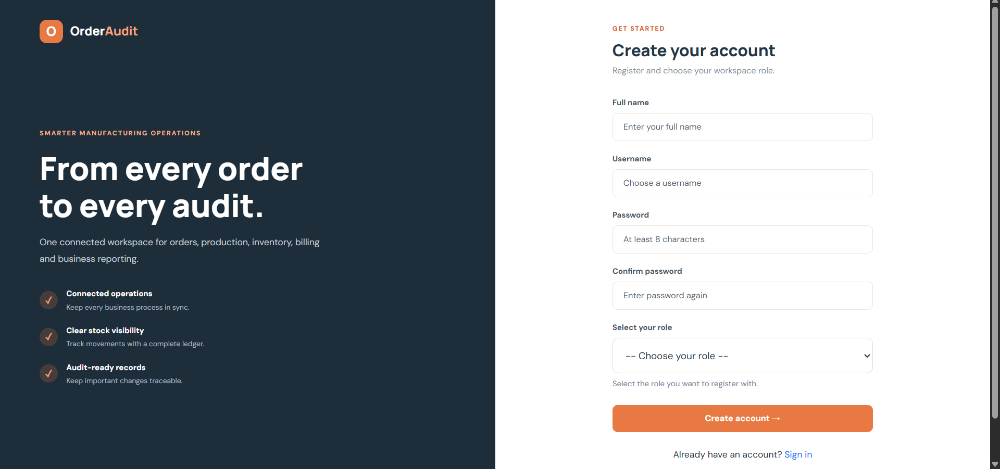
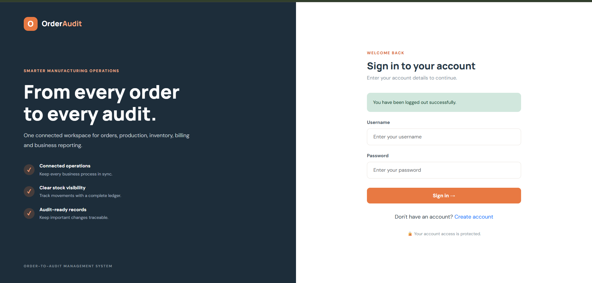
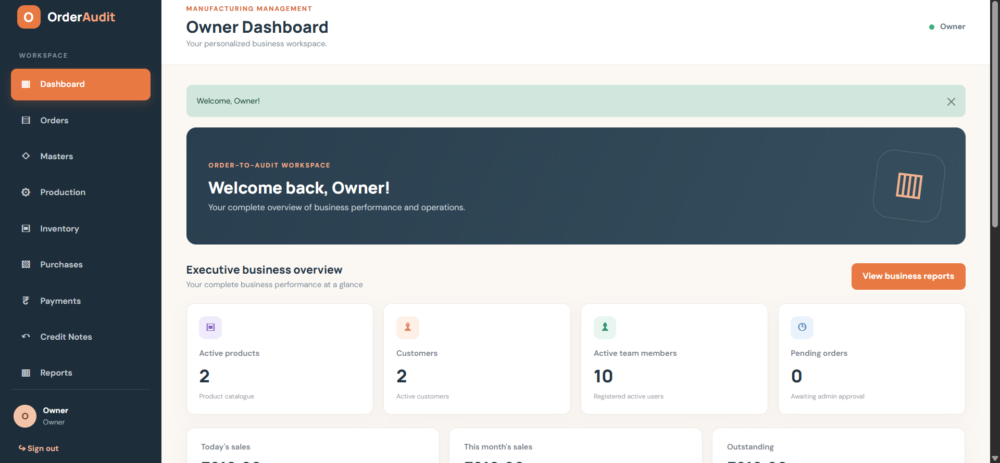
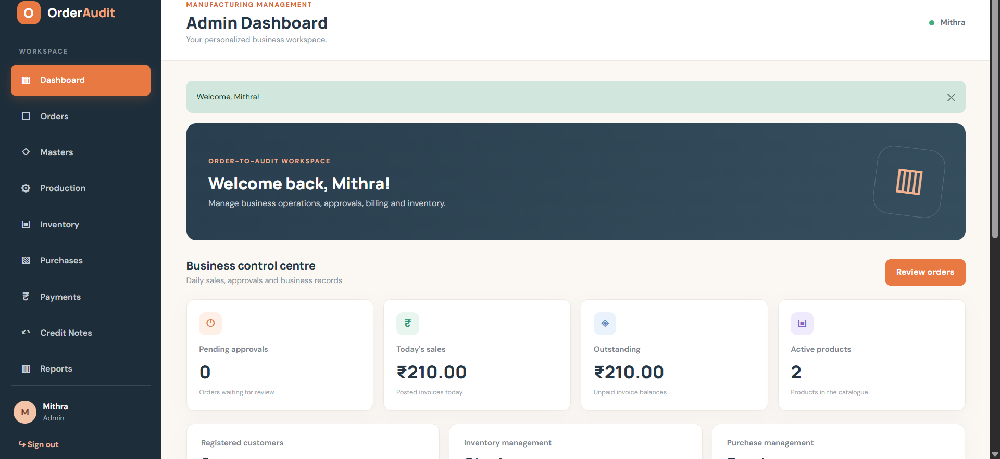
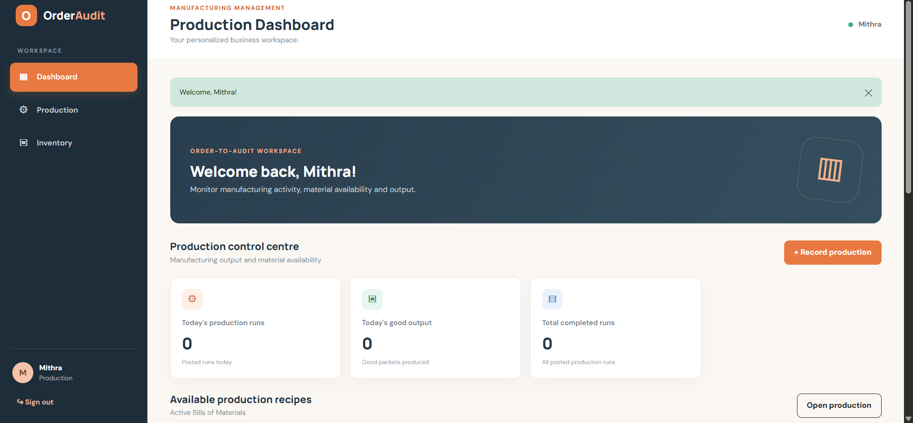
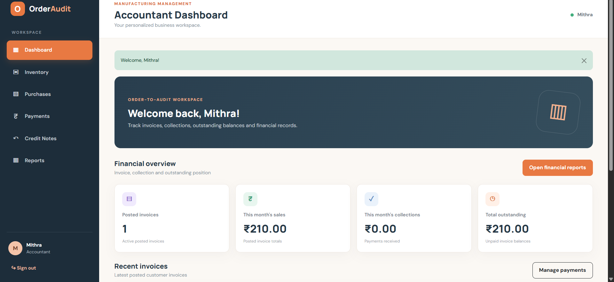

# 🏭 Order-to-Audit Manufacturing Management System

### An Integrated Manufacturing, Order Processing, Inventory and Audit Management Application

**Order-to-Audit** is a web-based manufacturing management system developed using Python Flask and SQLite. It is designed to manage the day-to-day operations of a small-scale snack manufacturing business through a single integrated platform.

The application connects sales, customer orders, production, inventory, purchases, GST invoicing, payments and reporting to improve business visibility and operational control.

---

## 📸 Application Screenshots

### 1. User Registration


### 2. Main Dashboard


### 3. Owner Dashboard


### 4. Admin Dashboard


### 5. Production Dashboard


### 6. Accountant Dashboard


### 7. Salesman Dashboard


---

## ✨ Key Features

### 1. User and Role Management
- User registration and login.
- Role-based access control.
- Separate dashboards for different business roles.
- Password hashing and session-based authentication.

### 2. Order Management
- Create and manage customer orders.
- Review and approve orders.
- Track order status.
- Monitor order fulfilment and dispatch.

### 3. Product and Customer Management
- Maintain product information.
- Manage customer records.
- Maintain raw material details.
- Configure product Bills of Materials (BOM).

### 4. Production Management
- Record planned and actual production.
- Track raw material consumption.
- Record production expenses.
- Monitor production output and wastage.
- Calculate production variance.

### 5. Inventory Management
- Track raw material stock.
- Monitor finished goods.
- Record stock movements.
- Maintain inventory visibility.

### 6. Purchase Management
- Record raw material purchases.
- Track purchase details.
- Update inventory through purchase transactions.

### 7. GST Invoice Management
- Generate customer invoices.
- Calculate applicable GST.
- Support CGST, SGST and IGST calculations.
- Track invoice amounts and balances.

### 8. Payment Management
- Record customer payments.
- Monitor outstanding amounts.
- Track payment history.

### 9. Reports and Audit Tracking
- Monitor business transactions.
- View operational reports.
- Track inventory and production performance.
- Maintain an audit trail of important activities.
- Export supported reports.

---

## 👥 User Roles

| User Role | Responsibilities |
|---|---|
| Owner | Overall business monitoring |
| Admin | Business masters, orders, approvals and management |
| Production Supervisor | Production entries and manufacturing activities |
| Accountant | Payments, accounts and reports |
| Salesman | Customer orders and order tracking |

---

## 🔄 Business Workflow

The application follows an integrated manufacturing workflow:

1. Admin maintains products, customers and raw materials.
2. Salesman creates customer orders.
3. Admin reviews and approves orders.
4. Production records manufacturing activities and material consumption.
5. Finished goods are updated in inventory.
6. Orders are dispatched and invoices are generated.
7. Accountant records customer payments.
8. Reports and audit records help monitor business operations.

---

## 🛠️ Technology Stack

| Technology | Purpose |
|---|---|
| Python | Backend programming |
| Flask | Web application framework |
| SQLite | Database management |
| HTML5 | Web page structure |
| CSS3 | User interface styling |
| JavaScript | Frontend interactions |
| Bootstrap 5 | Responsive design |
| Jinja2 | Template rendering |
| ReportLab | PDF generation |
| Werkzeug | Password hashing |

---

## 📂 Project Structure

```text
order-to-audit/
│
├── app.py
├── logic.py
├── schema.sql
├── seed.py
├── test_logic.py
├── requirements.txt
├── Dockerfile
├── docker-compose.yml
├── README.md
├── DESIGN.md
│
├── static/
│   └── style.css
│
├── templates/
│   ├── base.html
│   ├── login.html
│   ├── dashboard.html
│   ├── order_new.html
│   ├── orders.html
│   ├── invoice.html
│   ├── production.html
│   ├── inventory.html
│   ├── masters.html
│   ├── payments.html
│   └── reports.html
│
└── screenshots/
    ├── registration.png
    ├── dashboard.png
    ├── owner-dashboard.png
    ├── admin-dashboard.png
    ├── production-dashboard.png
    ├── accountant-dashboard.png
    └── salesman-dashboard.png
```

---

## 🚀 Installation and Setup

### Prerequisites

- Python 3.10 or above
- Git
- Visual Studio Code (recommended)

### Step 1: Clone the Repository

```bash
git clone https://github.com/Mithra-ramesh-12/order-to-audit.git
```

### Step 2: Navigate to the Project

```bash
cd order-to-audit
```

### Step 3: Create a Virtual Environment

```bash
python -m venv venv
```

### Step 4: Activate the Environment

For Windows PowerShell:

```powershell
.\venv\Scripts\Activate.ps1
```

### Step 5: Install Dependencies

```bash
pip install -r requirements.txt
```

### Step 6: Initialize the Database

```bash
python seed.py
```

Run the seed script for the initial demonstration database.

### Step 7: Start the Application

```bash
python app.py
```

### Step 8: Open the Application

Visit:

**http://127.0.0.1:5000**

---

## 🔐 Demo Login Credentials

| Role | Username | Password |
|---|---|---|
| Owner | owner | owner123 |
| Admin | admin | admin123 |
| Production | production | prod123 |
| Accountant | accountant | account123 |
| Salesman A | salesa | sales123 |
| Salesman B | salesb | sales123 |

**Security note:** These credentials are for local demonstration only. Do not use them in a production environment.

---

## 📊 Sample Business Scenario

The application demonstrates a sample Murukku 200g manufacturing workflow.

| Parameter | Sample Value |
|---|---:|
| Product | Murukku 200g |
| Selling Price | ₹50 per packet |
| GST Rate | 5% |
| Planned Production | 200 packets |
| Actual Good Production | 188 packets |
| Retailer A Order | 150 packets |
| Retailer A Payment | ₹4,000 |

This scenario demonstrates production tracking, inventory updates, order processing, GST invoicing and outstanding payment monitoring.

---

## 🔒 Security and Data Management

- Passwords are stored using secure password hashing.
- Role-based access is used to control application features.
- Database files are excluded from version control.
- Environment files and secrets are excluded through `.gitignore`.
- Important business activities can be tracked through audit records.

---

## 🎯 Project Objective

The primary objective of Order-to-Audit is to simplify and integrate the operational activities of a small-scale manufacturing business.

The system aims to reduce manual record maintenance, improve inventory visibility, monitor production efficiency, support accurate billing and provide better accountability through integrated business records.

---

## ⚠️ Disclaimer

This project is an internship prototype developed for educational and demonstration purposes. It should undergo additional security, accounting and business validation before being used in a real manufacturing environment.

---

## 🔗 GitHub Repository

**Project Repository:**  
https://github.com/Mithra-ramesh-12/order-to-audit

**Project Name:** Order-to-Audit Manufacturing Management System

**Project Type:** Internship Project / Web Application

**Status:** Prototype

